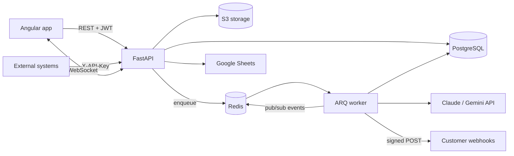

# DocuFlow API

[](https://github.com/jesus1244/docuflow-api/actions/workflows/ci.yml)


**AI document processing backend.** Upload invoices, receipts, contracts or purchase orders
(PDF or image). An AI model (Claude or Gemini) extracts structured data, a human reviews it, and DocuFlow delivers it
to other systems through **signed webhooks**, **CSV** or **Google Sheets**, with **live progress
over WebSockets**.

> Frontend: [docuflow-web](https://github.com/jesus1244/docuflow-web) (Angular 22)

---

## Features

| Area | What it does |
|---|---|
| **AI extraction** | Pluggable providers: **Claude** (`claude-opus-5-5`, adaptive thinking, refusal fallback) or **Gemini** (AI Studio key or Vertex AI). Both read PDFs and images natively and return JSON validated against the same Pydantic schema (structured outputs), with token usage tracked per document. An offline **mock extractor** lets you run everything without an API key. |
| **Async processing** | Uploads return `202 Accepted`. An **ARQ worker** (Redis) processes the file, retries transient AI errors with backoff, and publishes progress. |
| **Real time** | `WS /api/v1/ws` streams `document.processing / completed / failed` events per user (Redis pub/sub). |
| **Webhooks** | Per-user endpoints, Stripe-style **HMAC-SHA256 signatures**, delivery log, exponential-backoff retries, **SSRF protection** (private/loopback IPs blocked, re-checked at send time). |
| **Integrations** | CSV export, Google Sheets append (service account), S3-compatible storage (AWS S3, SeaweedFS, MinIO, R2). |
| **Auth** | JWT access + **rotating refresh tokens with reuse detection**, Argon2id passwords, **personal API keys** (`X-API-Key`) for machine clients, Redis rate limiting. |
| **Human review** | Correct extracted fields; fires a `document.reviewed` webhook. |
| **Analytics** | Stats aggregated in SQL: counts by status/type, totals per currency, 30-day series, AI token usage, average processing time. |
| **Ops** | Structured JSON logs with request IDs, liveness/readiness probes, multi-stage non-root Docker image, CI (lint, types, tests, image build). |

## Architecture



**Processing flow:** `POST /documents` → validate magic bytes → store in S3 → row `pending` →
enqueue → worker sets `processing` (WS event) → AI extraction → `completed` (WS event) →
webhook deliveries enqueued → each delivery signed, sent, retried, logged.

## Project structure

Organized **by domain** (following the [fastapi-best-practices](https://github.com/zhanymkanov/fastapi-best-practices) conventions):

```
src/docuflow/
├── core/          # config, database, security, redis, storage, queue, events, logging, errors
├── auth/          # users, JWT + refresh rotation, API keys
├── documents/     # upload, extraction (Claude/Gemini/mock), tasks, stats, exports
├── webhooks/      # endpoints, signing, delivery + retries, SSRF guard
├── integrations/  # Google Sheets
├── realtime.py    # WebSocket endpoint
├── worker.py      # ARQ worker settings
└── main.py        # app factory
migrations/        # Alembic (async), reversible, date-prefixed files
tests/             # pytest + httpx AsyncClient against real Postgres
```

Each domain has `router.py` (HTTP only) → `service.py` (business logic) → `models.py` (SQLAlchemy 2
typed models) with `schemas.py` (Pydantic v2) and `dependencies.py` (validation such as ownership checks).

## Quick start

**Everything in Docker:**

```bash
cp .env.example .env
docker compose up --build
```

- API docs (Swagger): http://localhost:8000/docs
- Health: http://localhost:8000/health/ready

**Local development (API on host, infra in Docker):**

```bash
docker compose up -d postgres redis
uv sync
uv run alembic upgrade head
uv run fastapi dev src/docuflow/main.py         # API with reload
uv run arq docuflow.worker.WorkerSettings        # worker (second terminal)
```

**Use a real AI extractor:** in `.env`, set `EXTRACTOR=claude` and `ANTHROPIC_API_KEY=...`, or
`EXTRACTOR=gemini` and `GEMINI_API_KEY=...` (or `GEMINI_USE_VERTEXAI=true` plus `GOOGLE_CLOUD_PROJECT`
for Vertex AI). Then run `docker compose up -d --build api worker`.

## API overview

| Method | Path | Description |
|---|---|---|
| POST | `/api/v1/auth/register` · `/login` · `/refresh` · `/logout` | Auth flow |
| GET | `/api/v1/auth/me` | Current user |
| GET/POST/DELETE | `/api/v1/auth/api-keys` | Personal API keys |
| POST | `/api/v1/documents` | Upload (multipart), returns 202 |
| GET | `/api/v1/documents?status=&document_type=&search=&limit=&offset=` | Paginated list |
| GET | `/api/v1/documents/stats` | Dashboard metrics |
| GET | `/api/v1/documents/export.csv` | CSV export |
| GET | `/api/v1/documents/{id}` · `/file` | Detail and original file |
| PUT | `/api/v1/documents/{id}/extracted-data` | Human review |
| POST | `/api/v1/documents/{id}/reprocess` · `/export/sheets` | Re-run AI, push to Sheets |
| GET/POST/PATCH/DELETE | `/api/v1/webhooks` | Webhook endpoints |
| POST | `/api/v1/webhooks/{id}/ping` | Test delivery |
| GET | `/api/v1/webhooks/{id}/deliveries` | Delivery log |
| WS | `/api/v1/ws?token=<access_token>` | Live events |

Example with an API key:

```bash
curl -X POST http://localhost:8000/api/v1/documents \
  -H "X-API-Key: dfk_xxxx_..." -F "file=@invoice.pdf"
```

### Verifying webhook signatures

Each delivery carries `X-DocuFlow-Signature: t=<unix>,v1=<hex>` where
`v1 = HMAC_SHA256(secret, "<t>.<raw body>")`:

```python
import hashlib, hmac, time


def verify(secret: str, body: bytes, header: str, tolerance: int = 300) -> bool:
    parts = dict(p.split("=", 1) for p in header.split(","))
    if abs(time.time() - int(parts["t"])) > tolerance:
        return False
    expected = hmac.new(
        secret.encode(), f"{parts['t']}.".encode() + body, hashlib.sha256
    ).hexdigest()
    return hmac.compare_digest(expected, parts["v1"])
```

Use the `id` field of the payload (also in `X-DocuFlow-Delivery`) to deduplicate retries.

## Quality

```bash
uv run ruff check . && uv run ruff format --check .   # lint + format
uv run mypy                                             # strict type checking
uv run pytest                                           # 49 tests, real Postgres via testcontainers
```

- Tests run the **Alembic migrations** to build the schema (so migrations are tested, up and down).
- The job queue runs **inline** in tests, so upload → extraction → webhook is tested end to end.
- External HTTP is mocked with `respx`; Redis with `fakeredis`; the Claude and Gemini clients with fakes.

## Design decisions

- **ARQ over Celery**: native asyncio, so the worker reuses the same async SQLAlchemy code as the API.
- **Provider-agnostic extraction**: one `Extractor` protocol, so switching between Claude and Gemini is a
  config change and nothing else in the app knows which model ran.
- **Structured outputs** instead of prompt-and-parse: the model's response is validated against the same
  `ExtractedData` model the API exposes, so there is a single source of truth for the schema.
- **Magic-byte detection**: the client's `Content-Type` is never trusted.
- **404 instead of 403** for other users' resources, so IDs are not leaked.
- **Webhook delivery rows** are created before sending, so every attempt is auditable and retryable.

## License

MIT
